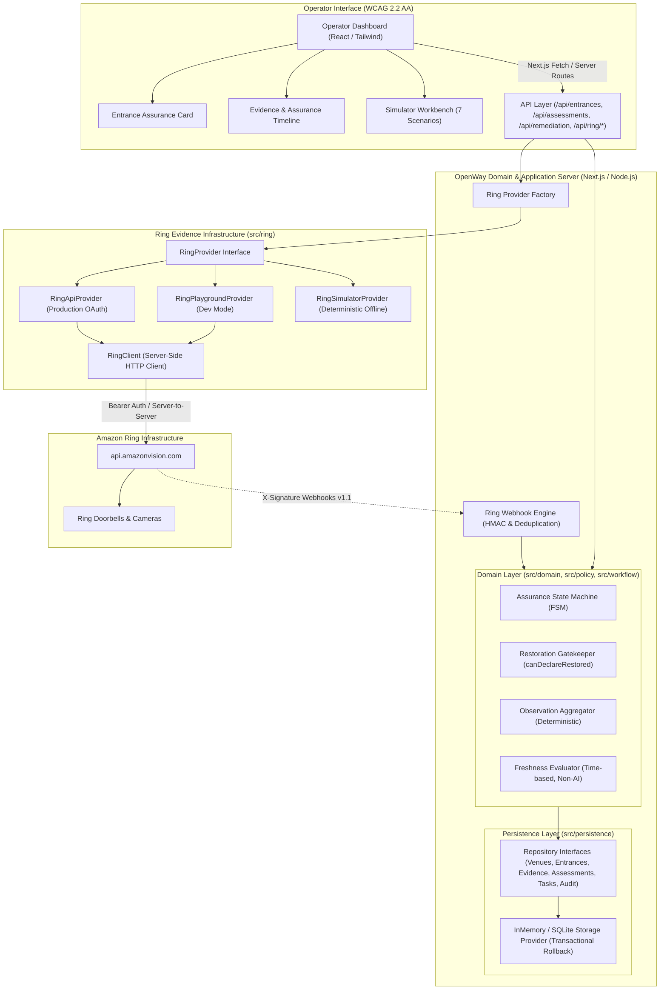

# OpenWay Architecture

OpenWay is built on a modular, decoupled architecture that separates hardware observation ingestion from accessibility assurance domain rules, evidence evaluation, and deterministic state transitions.

---

## High-Level Architecture Diagram

---

## Core Architectural Rules

### Rule 1: Ring is Evidence Infrastructure
The Ring layer supplies raw events, device context, timestamps, and media evidence:
- Device discovery and status via JSON:API compound documents (`GET /v1/devices?include=status,capabilities`)
- Motion detection notifications and doorbell button presses via Webhook v1.1
- Image snapshots via `POST /v1/devices/{id}/media/image/download`
- Video clips and two-way audio capabilities

The Ring adapter layer contains **no business rules or accessibility policy logic**.

### Rule 2: AI Does NOT Control State Transitions
Computer vision analyzers and rule systems generate structured observations with explicit tri-state values (`"TRUE" | "FALSE" | "UNKNOWN"`). AI never outputs `VERIFIED_RESTORED`, and the application never delegates state transitions to model predictions.

### Rule 3: Fresh Evidence is Mandatory for Restoration
Staff reporting a task complete (`COMPLETED`) moves an entrance to `RECHECKING`. Access is **never** declared restored until fresh post-remediation evidence passes the deterministic gatekeeper.

### Rule 4: UNKNOWN is a Valid and Safe State
When evidence is missing, stale, contradictory, or unbound, OpenWay transitions to `UNKNOWN`. It never converts uncertainty into a false green "Assured".

---

## Module Breakdown

### 1. Domain Layer (`src/domain/`)
- `types.ts`: Core entities including `Venue`, `Entrance`, `CameraBinding`, `AccessibilityRequirements`, `RemediationTask`, `AccessAssessment`, and `AuditEvent`.
- `CameraBinding`: Explicit hardware binding (`deviceId`, `componentId`). Model heuristics never guess which camera observes an entrance.
- `AccessibilityRequirements`: Typed physical conditions (`pathwayClear`, `obstructionFree`, `doorReady`).

### 2. Evidence Layer (`src/evidence/`)
- `types.ts`: Provider-neutral `Evidence` schema with strict provenance tracking (`OFFICIAL_RING`, `SIMULATED_LOCAL`, `OPENWAY_DERIVED`) and tri-state `AccessibilityObservation`.
- `freshness.ts`: Pure deterministic freshness evaluator based on capture timestamp, evaluation time, max age thresholds, and clock drift tolerance.
- `aggregation.ts`: Evaluates evidence freshness, camera binding, requirements satisfaction, and contradictory observations.

### 3. Policy Layer (`src/policy/`)
- `restorationGatekeeper.ts`: Pure deterministic function implementing `canDeclareRestored`. Enforces all 9 mandatory conditions before declaring `VERIFIED_RESTORED`.

### 4. Workflow & Orchestration Layer (`src/workflow/`)
- `accessAssuranceOrchestrator.ts`: Async processing boundary for Ring events. Coordinates event correlation, fresh evidence acquisition, multimodal vision inference, state transitions, and remediation dispatch with deduplication (`provider_eventId_deviceId`).
- `eventCorrelator.ts`: Deterministically maps Ring events to configured entrances via `deviceId` and `componentId`. Rejects unbound hardware (`UNBOUND_DEVICE`) with audit logging.
- `recheckService.ts`: Bounded post-remediation verification workflow. Explicitly requests fresh Ring evidence captured after staff completion (`capturedAt >= completedAt`), invokes pure `RestorationGatekeeper`, and transitions to `VERIFIED_RESTORED`, `ACTION_REQUIRED`, or `UNKNOWN`.
- `eventReconciliation.ts`: Lightweight event history recovery abstraction. Recovers missed Ring events after transient outages and replays them idempotently through the orchestrator.
- `stateMachine.ts`: Deterministic Assurance State Machine (`AVAILABLE`, `INTERRUPTED`, `ACTION_REQUIRED`, `RECHECKING`, `VERIFIED_RESTORED`, `UNKNOWN`) with invalid transition rejection and structured logging.
- `simulatorWorkflow.ts`: Exercises the full Phase 4 demo suite (Scenarios A through H) using the same application services as production code.

### 5. Evidence Layer (`src/evidence/`)
- `evidenceAcquisition.ts`: Acquires fresh visual evidence from Ring media download endpoints (`latest_in_range` / `at_timestamp`), preserves camera provenance, evaluates capture-time freshness, and handles in-memory JPEG buffers.
- `types.ts`: Provider-neutral `Evidence` schema with strict provenance tracking (`OFFICIAL_RING`, `SIMULATED_LOCAL`, `OPENWAY_DERIVED`) and tri-state `AccessibilityObservation`.
- `freshness.ts`: Pure deterministic freshness evaluator based on capture timestamp, evaluation time, max age thresholds, and clock drift tolerance.
- `aggregation.ts`: Evaluates evidence freshness, camera binding, requirements satisfaction, and contradictory observations.

### 6. Persistence Layer (`src/persistence/`)
- `repositories.ts`: Clean repository contracts decoupling the domain from storage engines (`VenueRepository`, `EntranceRepository`, `EvidenceRepository`, `ObservationRepository`, `AssessmentRepository`, `RemediationTaskRepository`, `AuditEventRepository`).
- `memoryStore.ts`: Transactional storage provider featuring atomic multi-entity transactions with snapshot-based rollback on failure.

### 7. Vision Layer (`src/vision/`)
- `VisionAnalyzer.ts`: Provider-neutral vision interface (`VisionAnalyzer`, `VisionAnalysisInput`, `DetailedVisionObservation`). Keeps Ring != Vision != Policy.
- `BedrockVisionAnalyzer.ts`: Implements multimodal analysis using AWS Bedrock Runtime Converse API (`amazon.nova-lite-v1:0`). Enforces platform-level tool calling JSON schemas (`record_accessibility_observation`) and Zod `.strict()` output validation.
- `SimulatorVisionAnalyzer.ts`: Deterministic simulated vision engine supporting CLEAR, BLOCKED, UNCERTAIN, and CONTRADICTORY scene evaluation.
- `VisionPipelineService.ts`: Pipeline coordinator implementing deduplication/cost-control idempotency keys, observation persistence, audit emission, and deterministic policy transition dispatch.
- `schemas.ts`: Strict Zod schema enforcing explicit tri-state enumerations (`"TRUE" | "FALSE" | "UNKNOWN"`) and rejecting extra fields.
- `prompts.ts`: Narrowly scoped system prompt prohibiting facial recognition, identity profiling, demographic inference, disability assessment, legal compliance claims, and state determination. Builds dynamic user prompt from configured `AccessibilityRequirements`.
- `errors.ts`: Maps upstream AWS Bedrock exceptions (401, 403, 429, 503, timeout) into typed `VisionAnalysisError` instances.
- `modelConfig.ts`: Environment-driven configuration (`AWS_REGION`, `BEDROCK_MODEL_ID`, `BEDROCK_GUARDRAIL_ID`, `BEDROCK_GUARDRAIL_VERSION`).

### 8. Ring Integration Layer (`src/ring/`)
- Server-side client, JSON:API compound document parser, media download handler, and webhook HMAC-SHA256 signature verification engine.

---

## Reliability & Fault Tolerance Matrix

| Failure Mode | Architectural Mitigation | Resulting State |
| :--- | :--- | :--- |
| **Evidence Stale** | Freshness evaluator rejects timestamps exceeding max age threshold. | `UNKNOWN` |
| **Contradictory Observations** | Aggregator flags conflicting fresh observations. | `UNKNOWN` |
| **Wrong Camera Evidence** | Gatekeeper and API reject evidence whose device/component does not match entrance binding. | `REJECTED` (State unaffected) |
| **Premature "Fixed" Claim**| Gatekeeper compares evidence `capturedAt` with remediation `completedAt`. | `RECHECKING` (Not restored) |
| **Upstream 429 Rate Limit** | Bounded exponential backoff with jitter in `RingClient`. | Operational continuity |
| **Duplicate Webhook** | In-memory sliding TTL cache keyed on `meta.request_id`. | Gracefully swallowed (`duplicate`) |
| **Storage Transaction Failure**| Snapshot restoration rolls back all partial mutations atomically. | Consistent pre-transaction state |
