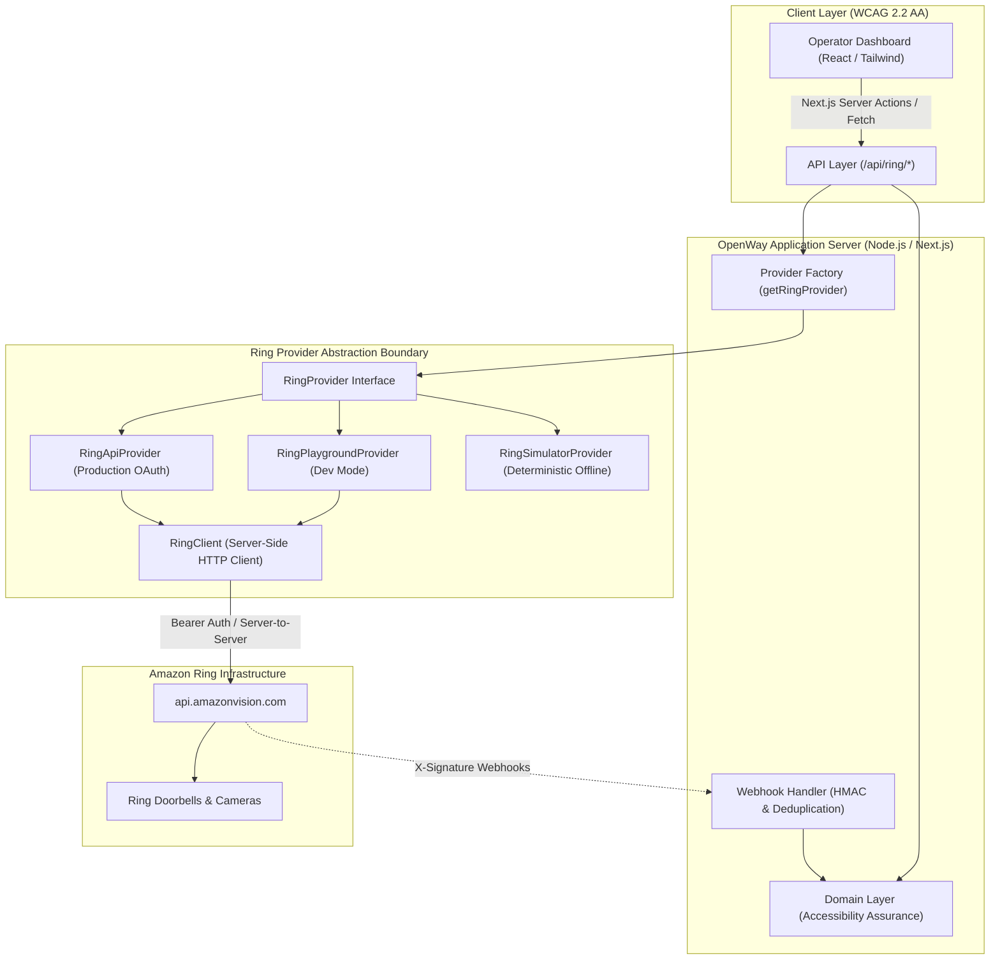

# OpenWay Architecture

OpenWay is built on a modular, decoupled architecture that separates hardware observation ingestion from accessibility assurance domain rules.

---

## High-Level Architecture Diagram



---

## Core Architectural Boundary: Ring Integration != Accessibility Policy

A fundamental tenet of OpenWay is:

```text
Ring integration != Accessibility policy
```

1. **The Ring Layer supplies observations, events, and evidence**:
   - Device discovery and status
   - Motion detection notifications
   - Image snapshots and video clips
   - Two-way audio capabilities

2. **The Domain Layer determines accessibility state**:
   - Maps camera observations to configured accessibility paths (e.g. wheelchair ramp, automatic sliding door).
   - Manages assurance lifecycle (`UNCONFIGURED` -> `ASSURED` -> `INTERRUPTED` -> `PENDING_VERIFICATION` -> `ASSURED`).
   - Enforces the core principle: **"An alert is not a resolution. A resolution is not verified until new evidence proves the physical state changed."**
   - No vendor-specific Ring API quirks or payload schemas pollute the domain layer.

---

## Component Breakdown

### 1. Provider Boundary (`src/ring/`)

- `RingProvider.ts`: Strongly typed interface defining device discovery, capabilities, status queries, snapshot retrieval, and event normalization.
- `RingPlaygroundProvider.ts`: Integrates with the Amazon Ring Developer Playground using short-lived developer tokens.
- `RingApiProvider.ts`: Production-ready Ring Partner API provider configured for OAuth 2.0 refresh tokens.
- `RingSimulatorProvider.ts`: In-memory deterministic simulator allowing complete offline testing, local demonstrations, and edge case reproduction.
- `RingClient.ts`: Server-side fetch client featuring:
  - Strict server-to-server isolation (credentials never reach client JavaScript).
  - UUID request correlation IDs (`X-Correlation-Id`).
  - Configurable timeouts (`AbortController`).
  - Bounded exponential backoff retries with jitter for 429 and 5xx errors (never retrying 401 or 403).
  - Sanitized structured logging preventing token or secret leakage.

### 2. Webhook Ingestion Engine (`src/ring/webhook.ts`)

- **Signature Verification**: Verifies incoming `X-Signature` headers using HMAC-SHA256 and constant-time buffer comparison (`crypto.timingSafeEqual`) to eliminate timing attack vectors.
- **Idempotency Cache**: Maintains a sliding 1-hour in-memory cache of processed `event_id`s to gracefully swallow duplicate deliveries without duplicate alert storms.
- **Immediate Response**: Responds to Ring with HTTP 200/202 in <50ms, delegating background normalization.

### 3. Domain Model (`src/domain/accessibility.ts`)

- `EntranceAssuranceStatus`: `ASSURED`, `INTERRUPTED`, `PENDING_VERIFICATION`, `UNCONFIGURED`, `DEGRADED`.
- `canDeclareRestored()`: Algorithmic gatekeeper ensuring that an interrupted state can only be marked resolved if fresh physical evidence was captured strictly **after** the interruption began, and proves the physical state changed.

---

## Reliability & Fault Tolerance

| Threat / Failure Mode | Architectural Mitigation |
| :--- | :--- |
| **Ring API Rate Limit (429)** | `RingClient` reads `Retry-After` header, executes bounded backoff (max 2 retries), and bubbles `RATE_LIMITED` error with retry advice. |
| **Network Timeout / Upstream Hang** | Request aborted after 8000ms via `AbortController`, translated to `UPSTREAM_TIMEOUT`. |
| **Token Expiration (401)** | Immediate halt without retry loops; dashboard reports `AUTHENTICATION_ERROR` with remediation instructions. |
| **Webhook Replay / Duplication** | Idempotency deduplication cache discards repeated event IDs with 202 status. |
| **Timing Attacks on Signatures** | Constant-time buffer comparison (`crypto.timingSafeEqual`). |
| **Sensitive Credential Exposure** | `sanitizeLogString()` regex scrubber filters bearer tokens, client secrets, and HMAC signatures from all stdout/stderr streams. |
