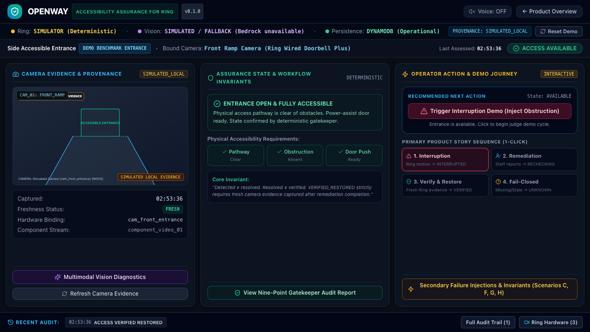

# OpenWay

> **Proactive, Event-Driven Accessibility Assurance for Ring**

[](LICENSE)
[](https://developer.ring.com)
[](https://aws.amazon.com)
[](src/test)
[](tsconfig.json)

---

## 1. Problem & Target Users

Over 1.3 billion people worldwide live with disabilities, including tens of millions who rely on wheelchairs, walkers, canes, or strollers to navigate physical spaces. While a venue can be legally listed as wheelchair-accessible, its physical entrance is frequently and unpredictably blocked:
- Delivery parcels are dropped directly across wheelchair access ramps.
- Construction scaffolding, trash bins, or patio furniture obstruct accessible door paths.
- Automatic power-assist door sensors fail silently or doors are wedged open.

Today, venues only discover these barriers when a visitor with a mobility disability arrives and cannot enter. Existing smart camera systems generate passive motion notifications that spam staff without coordinating remediation. Worse, traditional property management systems treat an employee clicking *"Resolved"* as proof of clearance—turning the dashboard green without ever verifying whether the physical obstruction was actually removed.

**Target Users**:
1. **Venue Operators & Facility Managers**: Coffee shops, restaurants, medical clinics, retail stores, transit hubs, and commercial offices that need to ensure their physical accessibility promises are continuously maintained.
2. **Floor & Facilities Staff**: Staff members who receive unambiguous, actionable remediation tasks with physical location context and camera snapshots.
3. **Visitors with Mobility Disabilities**: People who depend on reliable, real-time physical entrance clearance before arriving at a venue.

---

## 2. OpenWay Solution & Canonical Invariant

> **OpenWay is a proactive, event-driven accessibility assurance system that uses Ring evidence to detect configured, camera-observable access interruptions, coordinate staff remediation, and verify physical restoration with fresh evidence.**

### The Canonical Invariant

```text
Detection ≠ Resolution ≠ Verification
```

> **"Detected is not resolved. Resolved is not verified until fresh evidence proves the physical condition changed."**

When staff reports an obstruction cleared, OpenWay **refuses to declare the entrance restored**. It demands fresh camera evidence captured *after* the remediation timestamp, evaluates physical clearance through structured multimodal observations and pure deterministic gatekeeper rules, and **fails closed to `UNKNOWN`** if evidence is missing, stale, occluded, or contradictory.

---

## 3. Live Product & Evaluation Links

- **Production Presentation Website**: [https://main.d2qhyx9vstga35.amplifyapp.com](https://main.d2qhyx9vstga35.amplifyapp.com)
- **Live Interactive Assurance Console**: [https://main.d2qhyx9vstga35.amplifyapp.com/console](https://main.d2qhyx9vstga35.amplifyapp.com/console)
- **System Health & Telemetry**: [https://main.d2qhyx9vstga35.amplifyapp.com/api/health](https://main.d2qhyx9vstga35.amplifyapp.com/api/health)
- **Hackathon Video**: Verified release video `openway_hackathon_demo_release.mp4` *(Public streaming link will be embedded upon final submission upload; see [DEMO.md](DEMO.md) for full scene-by-scene script)*
- **Judge Quickstart Guide**: [JUDGE.md](JUDGE.md) *(Frictionless 60-second evaluation walkthrough)*
- **Developer Friction Log**: [docs/developer-friction-log.md](docs/developer-friction-log.md) *(Authentic engineering reflections on Bedrock, Ring, DynamoDB, and Amplify)*

The live console at `/console` opens immediately into **OpenWay Demo Café — Side Accessible Entrance** with baseline state **ACCESS AVAILABLE**. **Zero login, zero AWS credentials, zero Ring hardware pairing, and zero local setup required for evaluators.**

---

## 4. Single-Screen Assurance Workbench

The OpenWay operator console unifies entrance assurance status, camera binding telemetry, real-time remediation tasks, the nine-point deterministic gatekeeper decision record, and an append-only audit trail in a single high-contrast, WCAG 2.2 AA compliant view:



---

## 5. Supported Application States

OpenWay's deterministic assurance state machine enforces six strictly governed operational states:

```text
       ┌──────────────┐
       │  AVAILABLE   │ ◄──────────────────────────────┐
       └──────┬───────┘                                │
              │ Ring Motion / Doorbell                 │
              │ Interruption Detected                  │
              ▼                                        │
     ┌─────────────────┐                               │
     │  INTERRUPTED    │                               │
     └────────┬────────┘                               │
              │ Remediation Task Dispatched            │
              ▼                                        │
     ┌─────────────────┐                               │
     │ ACTION_REQUIRED │                               │
     └────────┬────────┘                               │
              │ Staff Reports Fixed                    │
              │ (Task Status: COMPLETED)               │
              ▼                                        │
     ┌─────────────────┐                               │
     │   RECHECKING    │ ─── Refuses False Green!      │
     └────────┬────────┘                               │
              │ Fresh Post-Remediation Evidence        │
              │ (capturedAt >= completedAt)            │
              ▼                                        │
     ┌─────────────────┐                               │
     │VERIFIED_RESTORED│ ──────────────────────────────┘
     └─────────────────┘
              ▲
              │ If evidence is missing, stale, occluded, or contradictory:
              ▼
       ┌──────────────┐
       │   UNKNOWN    │ ─── Fails closed safely; never guesses!
       └──────────────┘
```

1. **`AVAILABLE`**: Baseline operational state. Camera evidence confirms configured accessibility conditions (ramp pathway clear, obstruction absent, door power-assist ready).
2. **`INTERRUPTED`**: An access barrier has been detected via camera event telemetry and confirmed by multimodal vision observation.
3. **`ACTION_REQUIRED`**: A structured remediation task has been dispatched to floor staff with camera evidence and physical instructions.
4. **`RECHECKING`**: Staff reported the task complete. **OpenWay strictly refuses to turn green.** The UI displays: *"Staff reported the obstruction cleared. Restoration has not been verified."*
5. **`VERIFIED_RESTORED`**: Fresh post-remediation Ring evidence (`capturedAt >= completedAt`) has been acquired and verified against all nine deterministic gatekeeper rules.
6. **`UNKNOWN`**: First-class fail-closed state. When evidence is missing, network requests timeout, frames are blurry, or observations conflict, OpenWay marks the entrance `UNKNOWN` rather than showing a dangerous false green.

---

## 6. The Nine-Point Deterministic Restoration Gatekeeper

State transitions in OpenWay are never controlled by AI. Amazon Bedrock serves solely as a subordinate evidence interpreter translating raw pixels into structured tri-state observations (`TRUE | FALSE | UNKNOWN`). The domain state is decided by the pure TypeScript `RestorationGatekeeper` (`src/policy/restorationGatekeeper.ts`).

**All 9 conditions must be simultaneously satisfied before access can be declared restored:**

| # | Condition | Verification Check | Fail-Closed Reason |
| :-: | :--- | :--- | :--- |
| **1** | **State Gate** | Current entrance state must be strictly `RECHECKING`. | `INVALID_STATE` |
| **2** | **Remediation Task** | Remediation task exists and has status `COMPLETED`. | `NO_REMEDIATION` / `REMEDIATION_INCOMPLETE` |
| **3** | **Temporal Ordering** | Verification evidence capture time postdates remediation completion (`capturedAt >= completedAt`). | `TEMPORAL_INCONSISTENCY` |
| **4** | **Entrance Scope** | Evidence `entranceId` and `venueId` exactly match the entrance being evaluated. | `WRONG_ENTRANCE` |
| **5** | **Camera Binding** | Evidence `deviceId` and `componentId` match the configured camera binding. | `WRONG_CAMERA_DEVICE` / `WRONG_CAMERA_COMPONENT` |
| **6** | **Evidence Freshness** | Authoritative capture timestamp is within `maxEvidenceAgeSeconds` (evaluated against capture time, not DB insertion time). | `EVIDENCE_STALE` |
| **7** | **Requirements Met** | Configured accessibility conditions (`pathwayClear`, `obstructionFree`, `doorReady`) are explicitly satisfied (`TRUE`). | `REQUIREMENTS_NOT_MET` |
| **8** | **Non-Contradiction** | Zero conflicting observations exist within the active verification window. | `CONTRADICTORY_OBSERVATIONS` |
| **9** | **Honest Provenance** | Evidence provenance matches the active environment (`OFFICIAL_RING` vs. `SIMULATED_LOCAL`). | `INVALID_PROVENANCE` |

Evaluators can click **"View Nine-Point Gatekeeper Audit Report"** on the live console at any time to inspect the dynamic pass/fail status of all 9 checks.

---

## 7. Architecture & Provenance Transparency

### Three-Tier Architecture

```text
┌────────────────────────────────────────────────────────────────────────┐
│                        Operator Interface Layer                        │
│   Next.js 14 App Router (SSR) • React • Tailwind • WCAG 2.2 AA Dark   │
│   Interactive Workbench • Gatekeeper Decision Modal • Audit Timeline   │
└───────────────────────────────────┬────────────────────────────────────┘
                                    │
┌───────────────────────────────────▼────────────────────────────────────┐
│                  Deterministic Domain & Policy Engine                  │
│   Pure TypeScript Finite State Machine (FSM)                           │
│   9-Point Restoration Gatekeeper (canDeclareRestored)                  │
│   Post-Remediation Verifier (temporalOrdering: capturedAt >= doneAt)   │
│   Event Correlator • Deduplication • Bounded Recheck Service           │
└──────────────┬──────────────────────────────────────────┬──────────────┘
               │                                          │
┌──────────────▼──────────────────────────┐ ┌─────────────▼──────────────┐
│        Ring Evidence Integration        │ │      AWS Cloud Infrastructure      │
│   RingClient (SSRF Origin Validation)   │ │  AWS Amplify Hosting (SSR)         │
│   Amazon Ring Partner API v1.1 (Spec)   │ │  Amazon DynamoDB (Single-Table)    │
│   RingPlaygroundProvider (Tokens)       │ │  - Idempotency Write Locks         │
│   RingSimulatorProvider (Deterministic) │ │  - Optimistic Concurrency          │
│   One-Way OAuth Linking (AES-256-GCM)   │ │  Amazon Bedrock (Converse API)     │
└─────────────────────────────────────────┘ └────────────────────────────┘
```

### Explicit Runtime & Provenance Disclosures

In strict adherence to Amazon hackathon honesty principles, OpenWay transparently categorizes and displays all runtime sources:

| Provenance Category | Exact Definition | Operational Status in Public Release |
| :--- | :--- | :--- |
| **`SIMULATOR (Deterministic)`** | Deterministic synthetic events, devices, and ramp imagery generated by `RingSimulatorProvider`. | **Active by default** in the public demo console so judges can evaluate all 7 scenarios without needing Ring hardware or developer credentials. |
| **`SPEC VERIFIED`** | Implementation strictly verified against official Amazon Ring Partner API specifications (JSON:API `/v1/devices`, HTTP 303 media downloads, HMAC webhooks). | **Verified** in automated contract tests. |
| **`LIVE RING VERIFIED`** | Executed against live Ring Developer Playground tokens or production hardware. | Supported via `.env.local` configuration. Production One-Way account linking is implemented, but genuine hardware pairing requires Amazon Ring Partner onboarding approval. |
| **`SIMULATED / FALLBACK`** | Synthetic ramp imagery evaluated by local simulated vision analyzer. | **Active in public deployment**: When Amazon Bedrock access returns Error 002 (model invocation restriction on the AWS account), OpenWay logs the error, falls back to simulated vision, and fails closed to `UNKNOWN` when conclusive evidence is absent. |
| **`NOT AVAILABLE`** | Capability unconfigured or hardware sensor absent. | Explicitly surfaced in diagnostics modal. |

---

## 8. Operational AWS Cloud Integrations

OpenWay leverages three foundational AWS services in production:

1. **AWS Amplify Hosting**:
   - Hosts full-stack Next.js 14 App Router application with Server-Side Rendering (SSR) and edge delivery.
   - Manages least-privilege IAM service execution roles granting server actions access to DynamoDB and Secrets Manager with zero client credential exposure.
2. **Amazon DynamoDB (`OpenWayTable`)**:
   - Single-table cloud storage with partition key `PK`, sort key `SK`, and Global Secondary Index `GSI1`.
   - Stores venues, entrance configurations, remediation tasks, assessment history, and append-only audit events.
   - Enforces atomic idempotency locks (`attribute_not_exists(PK)`) to guarantee duplicate webhooks or replay attempts never cause duplicate workflows.
   - Enforces optimistic concurrency (`version = :expectedVersion`) on state updates to prevent race conditions during rapid recheck requests.
3. **Amazon Bedrock Runtime (`amazon.nova-lite-v1:0`)**:
   - Multimodal Converse API analyzing camera snapshots in volatile server memory buffers.
   - Strictly constrained by Zod schema tool calling (`record_accessibility_observation`) returning provider-neutral tri-state values.

---

## 9. Local Setup & Reproduction

### Prerequisites
- Node.js >= 18.17 (Node 20 or Node 22 recommended)
- npm >= 9.0

### Quickstart

```bash
# 1. Clone the repository
git clone https://github.com/subodhkant7/openway.git
cd openway

# 2. Install dependencies
npm ci

# 3. Run the full automated test suite (303 tests across 37 test files)
npm run test

# 4. Run TypeScript strict typecheck (zero errors)
npm run typecheck

# 5. Run ESLint code quality checks (zero warnings or errors)
npm run lint

# 6. Build the Next.js production bundle
npm run build

# 7. Start local development server
npm run dev
```

Open [http://localhost:3000](http://localhost:3000) in your browser. The default configuration runs in simulator mode with **zero external credentials required**.

### Safe Environment Configuration (`.env.example`)

The repository includes a safe [.env.example](.env.example) containing **placeholders only**. To run with optional live services:

```env
# Provider Mode (simulator | playground)
OPENWAY_PROVIDER=simulator

# Amazon Bedrock Credentials (Optional for local Bedrock vision)
AWS_REGION=us-east-1
AWS_ACCESS_KEY_ID=your_aws_key
AWS_SECRET_ACCESS_KEY_ID=your_aws_secret
BEDROCK_MODEL_ID=amazon.nova-lite-v1:0

# Ring Developer Playground Credentials (Optional for Playground mode)
RING_ACCESS_TOKEN=your_short_lived_playground_token
RING_API_BASE_URL=https://api.amazonvision.com
RING_WEBHOOK_SECRET=your_hmac_secret
```

---

## 10. Frictionless Demo Walkthrough (< 60 Seconds)

Evaluators can verify the entire assurance lifecycle directly on the [Live Console](https://main.d2qhyx9vstga35.amplifyapp.com/console):

1. **Confirm Baseline**: Entrance displays **`ACCESS AVAILABLE`** (Green).
2. **Click `1. PREEMPTIVE OBSTRUCTION`**: Ring motion event ingested &rarr; obstruction detected on ramp &rarr; status transitions to **`ACCESS INTERRUPTED`** &rarr; Remediation task dispatched to staff.
3. **Click `2. STAFF REMEDIATION`** (or click "Report Fixed"): Task marked completed &rarr; entrance moves to **`RECHECKING`**. **Notice the UI strictly refuses to turn green.**
4. **Click `3. CANONICAL VERIFICATION`**: Fresh post-remediation frame acquired (`capturedAt >= completedAt`) &rarr; all 9 gatekeeper checks pass &rarr; status transitions to **`ACCESS RESTORED — VERIFIED`**.
5. **Click `4. FAILURE DEMO 1: UNAVAILABLE`**: Simulates camera media outage &rarr; status safely transitions to **`UNKNOWN`** (Fail-Closed).
6. **Inspect Gatekeeper**: Click **"View Nine-Point Gatekeeper Audit Report"** to inspect the evaluated rule checklist.
7. **Inspect Audit Trail**: Switch to the **Timeline** tab on the right panel to inspect the append-only chronological audit log.
8. **Click `Reset Demo Narrative`**: Restores the demo venue cleanly to baseline `ACCESS AVAILABLE`.

---

## 11. Test & Verification Summary

The OpenWay test suite provides exhaustive coverage across temporal semantics, security defenses, concurrency, and API contracts:

| Verification Scope | Status | Metric | Verification Target |
| :--- | :---: | :---: | :--- |
| **Automated Tests** | **PASS** | **303 / 303** | 303 passing tests across 37 test files (`npm run test`). |
| **TypeScript** | **PASS** | **Zero errors** | Strict type checking with zero `any` evasions (`tsc --noEmit`). |
| **Code Quality** | **PASS** | **Zero warnings** | Clean ESLint verification (`next lint`). |
| **Production Build** | **PASS** | **Standalone** | Next.js App Router optimized production build (`next build`). |
| **Gatekeeper Invariants** | **PASS** | **12 / 12** | Pure unit tests for all 9 gatekeeper conditions and fail-closed branches. |
| **Adversarial Security** | **PASS** | **31 / 31** | SSRF redirect defense, replay attacks, temporal inversion, stale evidence injection. |
| **Concurrency & Locks** | **PASS** | **7 / 7** | Optimistic locking retry loops, DynamoDB atomic idempotency write locks. |
| **Multi-Tenant Isolation** | **PASS** | **10 / 10** | Strict venue ID boundaries; cross-tenant request rejection. |
| **Ring Contract Tests** | **PASS** | **47 / 47** | JSON:API compound document normalization, 303 media download redirects, HMAC signatures. |

---

## 12. Security & Privacy Principles

OpenWay is built on privacy-by-design and least-privilege principles:

1. **Environmental Observation Only**: OpenWay observes physical doorways, ramps, and pathways. It performs **zero facial recognition**, **zero biometric identification**, and **zero disability inference**.
2. **Ephemeral Memory Processing**: Raw camera images are analyzed strictly in volatile server memory buffers and dropped immediately following inference. No camera images are permanently stored on disk or in public buckets.
3. **SSRF Redirect Hardening**: Ring media downloads validate redirect destinations against strict allowlists (`*.ring.com`, `*.amazonvision.com`, `*.amazonaws.com`), blocking SSRF attacks against AWS metadata services (`169.254.169.254`) and internal RFC 1918 subnets.
4. **Tenant Isolation**: All database operations and API routes enforce strict venue boundaries with authenticated session checks.
5. **Security Documentation**: See [SECURITY.md](SECURITY.md), [docs/security-model.md](docs/security-model.md), [docs/threat-model.md](docs/threat-model.md), and [docs/aws-iam.md](docs/aws-iam.md).

---

## 13. Limitations & Non-Goals

In accordance with strict hackathon transparency, OpenWay documents its real-world operational boundaries:

1. **Event-Driven, Not Continuous Inspection**: OpenWay does not continuously stream video; detection depends on observable Ring events (motion, doorbell rings, scheduled rechecks).
2. **Camera-Observable Conditions Only**: OpenWay only evaluates physical conditions explicitly observable by cameras and configured by the venue (e.g. ramp clearance, doorway paths). Camera observation cannot certify legal ADA compliance or municipal building code adherence.
3. **Evidence Unavailability Fails Closed**: When camera evidence is missing, blurred, or occluded, OpenWay produces `UNKNOWN`. It will never guess or claim restoration without proof.
4. **Camera Tampering & Occlusion**: Physical camera lens occlusion, network outages, or camera tampering will prevent evidence capture and safely resolve the entrance state to `UNKNOWN`.
5. **No Direct Actuation**: OpenWay verifies physical status and coordinates staff remediation; it does not autonomously actuate physical door motors or remove physical obstructions.
6. **Playground Token Expiration**: Developer Playground tokens expire in ~30–60 minutes and require periodic refresh in sandbox mode.
7. **Simulation Disclosure**: Sandbox demonstration evidence is synthetic and explicitly labeled as `SIMULATED RING`.

---

## 14. Documentation Sitemap

- [DEMO.md](DEMO.md) — Three-minute demo video script, scene-by-scene storyboard, and judge walkthrough.
- [JUDGE.md](JUDGE.md) — Concise evaluation guide, operational vs. simulated inventory, and invariant checklist.
- [ARCHITECTURE.md](ARCHITECTURE.md) — Decoupled system architecture, module breakdown, and fault tolerance matrix.
- [docs/developer-friction-log.md](docs/developer-friction-log.md) — 4 authentic technical friction entries with actionable suggestions.
- [docs/hackathon.md](docs/hackathon.md) — Amazon Developer Hackathon evaluation, Stage 2 criteria alignment, and AWS Builder challenge details.
- [SECURITY.md](SECURITY.md) — Vulnerability disclosure policy and security architecture overview.
- [docs/security-model.md](docs/security-model.md) — Detailed security controls, SSRF protections, and tenant boundaries.
- [docs/aws-iam.md](docs/aws-iam.md) — Least-privilege IAM policies for Amplify, DynamoDB, Bedrock, and Secrets Manager.

---

## License

This project is open-source software licensed under the terms of the [MIT License](LICENSE).  
Copyright &copy; 2026 Subodh Kant.
